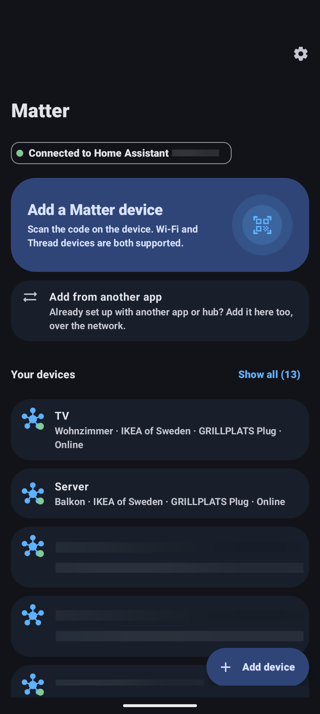
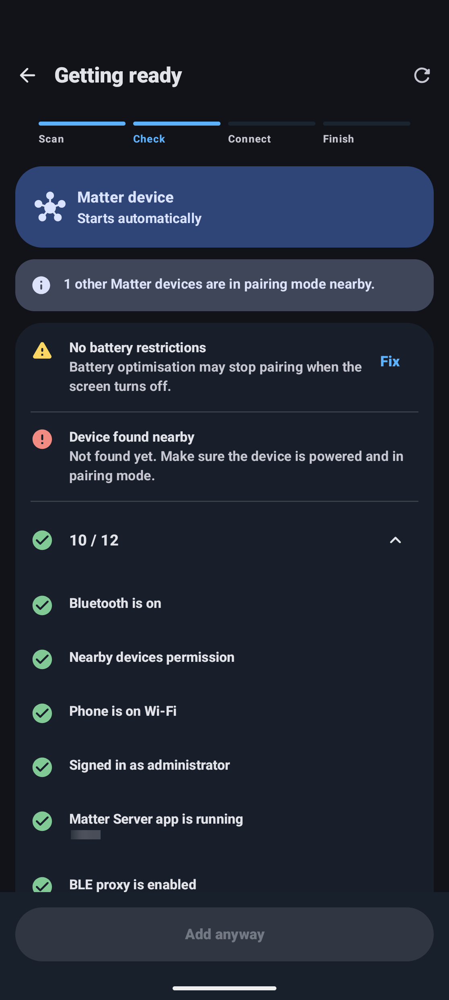
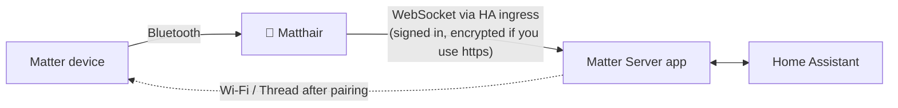
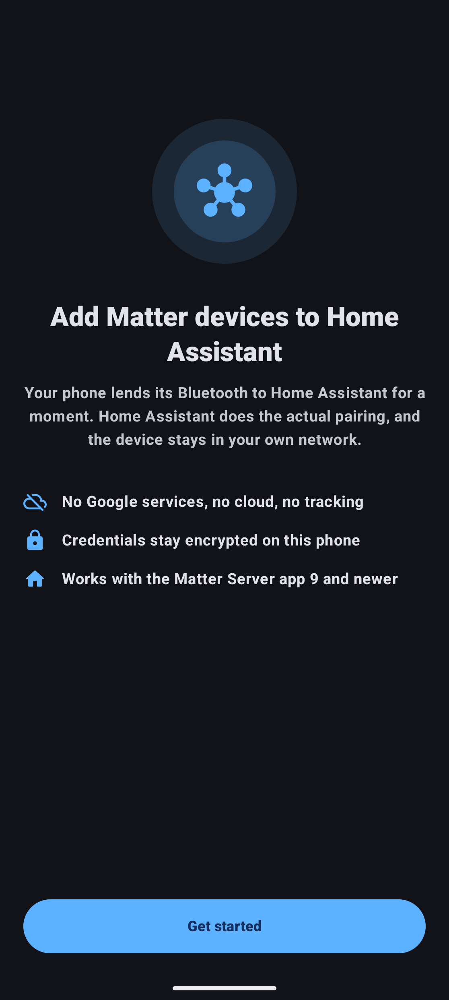
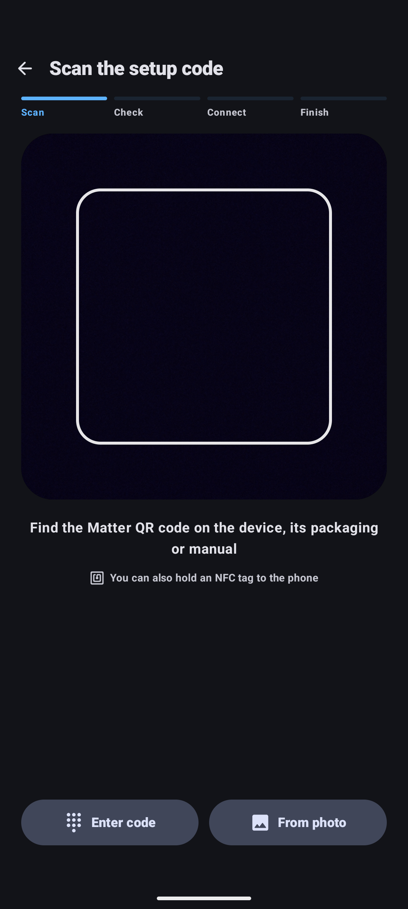

<p align="center">
  
</p>

<h1 align="center">Matthair</h1>

<p align="center">
  <b>Add Matter devices to Home Assistant from your phone. No Google services needed.</b><br>
  Made for /e/OS, LineageOS, GrapheneOS and every other de-Googled Android.
</p>

<p align="center">
  <a href="LICENSE"></a>
  
  
  
</p>

<p align="center">
  
  
  
  
</p>

---

## Why?

On a normal Android phone, adding a Matter device to Home Assistant goes through Google Play
Services. Without them the official route simply does not work, and as a side effect every
device also ends up in a Google "ecosystem".

Matthair takes a different path: **your phone only lends its Bluetooth to Home Assistant.**
Home Assistant's Matter Server does the actual pairing through its built-in Bluetooth proxy
protocol. The device's credentials, your Wi-Fi password and your Thread network never pass
through the phone and never leave your home.



## Features

**Adding devices**
- A short guided flow: **scan → check → pair → name**
- Scan the QR code offline, type the 11 or 21 digit code (typos are caught), pick a photo of the code, or tap an NFC tag
- A traffic-light check before pairing, with one-tap fixes for whatever is missing: Bluetooth,
  permissions, battery optimisation, Matter Server version and its `ble_proxy` option, Thread
  network and border routers, Wi-Fi credentials, competing Bluetooth proxies and the device's signal
- Wi-Fi credentials without typing: the network name is filled in, and a Wi-Fi QR code (router
  sticker or Android's *Share Wi-Fi*) fills in the password
- Live progress from Bluetooth to secure session to network, with automatic retries for flaky Bluetooth
- Plain-language error messages with concrete next steps, plus a redacted diagnostic bundle

**Managing devices**
- Device list with online/offline state
- Device page with network (Thread or Wi-Fi), IP address, firmware, model and serial number
- Rename a device and change its room
- See which **ecosystems** a device belongs to and remove foreign ones, e.g. an old Google connection
- Share a device with another ecosystem (Apple Home, Alexa, …) via QR code, or add one that is already in another ecosystem
- Remove a device

**Everything else**
- English and German, light and dark theme, Material You colours
- Optional: start Zigbee pairing mode for ZHA or Zigbee2MQTT

## Requirements

| | |
|---|---|
| **Phone** | Android 12 or newer with Bluetooth LE. Google Play Services and microG are not needed. |
| **Home Assistant** | 2026.6 or newer, installed as **HA OS or Supervised** (Matthair talks to the Matter Server through HA's ingress) |
| **Matter Server app** | Version 9 or newer, with the option **`ble_proxy`** turned on (Matthair can turn it on for you) |
| **HA account** | An administrator |
| **Thread devices** | A preferred Thread network in HA and a border router |
| **Wi-Fi devices** | A 2.4 GHz Wi-Fi network |

## Getting started

1. Install Matthair (F-Droid release is on its way, until then see [Building](#building)).
2. Enter your Home Assistant address, e.g. `http://homeassistant.local:8123`.
   If you mix up http/https or forget the port, Matthair finds the right one.
3. Sign in on Home Assistant's own login page (a long-lived access token works too).
4. Tap **Add device**, scan the code on the device or its box, and follow the steps.

<p align="center">
  
  
  
  
</p>

## FAQ

<details>
<summary><b>My device shows "Google LLC" under connected ecosystems. Why?</b></summary>

It was paired at some point through Google Home or through the official Home Assistant app
with Google Play Services, which first adds devices to Google's ecosystem and then shares them
with HA. Open the device in Matthair and tap **Remove** next to Google. The device stays in Home
Assistant. Devices added with Matthair only ever join Home Assistant.
</details>

<details>
<summary><b>Why can't Matthair just use the Wi-Fi password saved on my phone?</b></summary>

Android does not allow any app to read saved Wi-Fi passwords. Matthair fills in the network name
and can read a Wi-Fi QR code, for example from your router's sticker or from *Settings → Wi-Fi →
Share* on another phone. You only enter it once: the Matter Server remembers it.
</details>

<details>
<summary><b>The device is found, but pairing never starts.</b></summary>

Another Bluetooth proxy (an ESPHome proxy or the Bluetooth adapter of your HA host) probably saw
the device first, and the Matter Server uses whoever reports a device first. Matthair warns you
when this happens. Move the phone close to the device and try again, or temporarily disable the
other proxy.
</details>

<details>
<summary><b>Does Matthair send anything to the internet?</b></summary>

No. It only talks to the Home Assistant addresses you entered. There is no analytics, crash
reporting or update check.
</details>

## Building

```bash
./gradlew :app:assembleDebug
```

```bash
./gradlew :app:testDebugUnitTest
```

- Use a HotSpot-based **JDK 17** such as Temurin. The OpenJ9 JVM crashed the Gradle daemon while dexing.
- Put the Android SDK path into `local.properties` (`sdk.dir=…`).
- Release builds are minified and contain no VCS info or dependency metadata, so F-Droid can reproduce them.

## How the code is organised

| Package | What lives there |
|---|---|
| `matter` | Setup code parsing (QR and manual code), the Matter Bluetooth advertisement, the passive BTP observer that detects PASE |
| `ble` | Android Bluetooth: scanning, a strictly sequential GATT connection, and the client of the Matter Server's BLE proxy protocol |
| `ha` | Home Assistant: sign-in, WebSocket API, ingress, the Matter Server WebSocket, and the typed `HaApi` |
| `commission` | The pre-flight check and the commissioning run with its retries and failure classification |
| `ui` | Jetpack Compose screens, navigation and the single `MainViewModel` |
| `data`, `util` | Encrypted settings, redacting log, diagnostics, Wi-Fi helpers |

## Documentation

| Document | Content |
|---|---|
| [Requirements (req42)](docs/requirements/req42.md) | Goals, stakeholders, functional and quality requirements with their status, acceptance criteria |
| [Architecture (arc42)](docs/architecture/arc42.md) | Context, building blocks, runtime, security concept, decisions, risks |
| [BLE proxy protocol](docs/ble-proxy-protocol.md) | The Matter Server's Bluetooth proxy WebSocket protocol and how Matthair implements it |
| [Matter protocol](docs/matter-protocol.md) | The parts of Matter Matthair relies on: setup codes, advertisement, BTP, PASE detection, multi-admin |

## Privacy and security

- Connects **only** to your Home Assistant.
- Sign-in tokens are encrypted with a key in the Android Keystore and excluded from backups.
- Setup codes stay in memory and are removed from every log line.
- Self-signed certificates are only accepted after you confirmed their fingerprint.

## Known limitations

- HA Container and Core installations are not supported, because they have no Supervisor and therefore no ingress.
- Matthair cannot force the Matter Server to use the phone when another Bluetooth proxy sees the
  device first. That needs a server-side option that does not exist yet.
- The "verifying" and "joining network" steps are estimated from the encrypted traffic. Only the
  secure session (PASE) is detected exactly.

## License

[GPL-3.0-or-later](LICENSE). Libraries: AndroidX and Jetpack Compose, OkHttp,
kotlinx.coroutines and kotlinx.serialization, ZXing core, all Apache-2.0.

Matthair is an independent project. "Matter" is a trademark of the Connectivity Standards
Alliance, and "Home Assistant" is a project of the Open Home Foundation. Matthair is not
affiliated with or endorsed by either.
