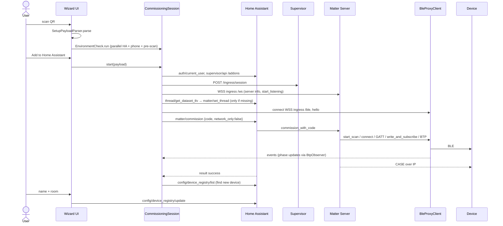

# MatterPair: Architecture (arc42)

Template: [arc42](https://arc42.org), version 8. Requirements are referenced by their IDs from
[req42](../requirements/req42.md).

---

## 1. Introduction and goals

MatterPair lets Home Assistant commission Matter devices **through the phone's Bluetooth**,
without Google Play Services. The phone is a pure **BLE proxy client** of the Matter Server.
Fabric, certificates, Wi-Fi credentials and the Thread dataset stay on the HA host. The phone
has no fabric and no Matter SDK.

### 1.1 Top quality goals

| Priority | Goal | req42 |
|----------|------|-------|
| 1 | **Privacy and security**: talk only to HA, never expose the unauthenticated `/ble`, keep the passcode in memory only | Q-1, Q-2, F-1.5 |
| 2 | **Reliability**: survive Android's BLE quirks (GATT 133, op serialisation, scan throttling, process kills) | Q-3, F-5.9 |
| 3 | **Usability**: a Google-like 4-step flow with plain-language help | G-2, Q-6 |
| 4 | **Maintainability**: small, documented, testable code with no proprietary SDKs | Q-8, C-1 |

### 1.2 Stakeholders

See [req42 §2](../requirements/req42.md#2-stakeholders).

## 2. Constraints

| Constraint | Consequence |
|-----------|-------------|
| No GMS/Firebase/ML Kit (C-1) | QR via ZXing core, no Google Code Scanner, no FCM, no Play Integrity |
| F-Droid reproducible build (C-2) | Pinned versions, `dependenciesInfo` off, `android.enableVcsInfo=false` |
| minSdk 31 (C-4) | New BLE permissions (`BLUETOOTH_SCAN` with `neverForLocation`); dynamic color always available |
| Matter Server ≥ 9 with `ble_proxy` (C-5) | Proxy protocol v1 is the integration point |
| Supervisor needed (C-6) | Ingress gives authenticated access to `/ble` and `/ws`. HA Container/Core are not supported |

## 3. Context and scope

### 3.1 Business context

| Partner | Input to MatterPair | Output from MatterPair |
|---------|---------------------|------------------------|
| User | Setup code (QR/manual/NFC/photo), names, rooms, confirmations | Progress, errors with fixes, device list |
| Matter device | BLE advertisements, GATT indications (BTP) | GATT writes (BTP), relayed byte-for-byte |
| Home Assistant | Auth, results, device and area registries, Thread datasets, Supervisor info | WebSocket commands (`matter/commission`, registry updates, …) |
| Matter Server (via ingress) | Proxy commands, binary BTP frames, server info, nodes | Proxy responses, events, notifications |

### 3.2 Technical context

| Channel | Protocol | Security |
|---------|----------|----------|
| Phone ↔ device | BLE GATT, service `0xFFF6` | Matter-level encryption after PASE |
| Phone ↔ HA | HTTPS + WSS `/api/websocket` (or HTTP on LAN) | HA access token (OAuth2 or LLAT) |
| Phone ↔ Matter Server | WSS `/api/hassio_ingress/<token>/{ble,ws}` | `ingress_session` cookie, admin only |
| HA ↔ Matter Server | WS `:5580/ws` on the host network | Host-local |

## 4. Solution strategy

| Problem | Approach |
|---------|----------|
| Commission without GMS | Do **not** commission on the phone. Let the Matter Server commission and lend it the radio (BLE proxy protocol) |
| `/ble` has no auth | Reach it only through **HA ingress** with an admin-issued session |
| Android GATT is fragile | One FIFO queue per connection, op-by-op with callbacks, GATT 133 retry, MTU 517, priority HIGH |
| BTP handshake race | Implement `write_and_subscribe` atomically and buffer early indications |
| Phases are invisible to the proxy | **Passive BTP observer**: decode unencrypted PASE messages and use size heuristics afterwards |
| Process killed on custom ROMs | `connectedDevice` foreground service while commissioning, battery-optimisation check |
| Several proxies race | Report only the matching device, detect "reported but never connected", plan for `ble_proxy_id` |
| UX like Google's flow | 4-step wizard: Scan → Check → Connect → Finish, with traffic-light pre-flight check |

## 5. Building block view

### 5.1 Level 1

```
io.github.dwicki.hamatterpair
├── ui/            Compose screens, MainViewModel, theme, labels (string mapping)
├── commission/    CommissioningSession (orchestrator), EnvironmentCheck, CommissioningService
├── ble/           BleScanner, GattConnection, BleProxyClient (proxy protocol v1)
├── ha/            HaConnector, HaWebSocket, HaApi, HaAuth, Ingress, MatterServerClient, HttpClients
├── matter/        SetupPayloadParser, MatterBle (advertisement), BtpObserver   ← pure Kotlin, unit-tested
├── data/          ConfigRepository, SecureStore (Keystore AES-GCM)
└── util/          AppLog + Redactor, Diagnostics
```

Dependencies point downward only: `ui → commission → ble/ha → matter/data/util`. `matter`
has no Android dependencies.

### 5.2 Level 2: key building blocks

| Block | Responsibility | Key collaborators |
|-------|----------------|-------------------|
| `SetupPayloadParser` | QR/Base38 and manual/Verhoeff parsing, validation | none |
| `BtpObserver` | Reassemble BTP segments and detect handshake, PASE start/success/failure, attestation heuristic | fed by `BleProxyClient` |
| `BleScanner` | Single shared `0xFFF6` scan, ref-counted, throttle-safe | EnvironmentCheck, BleProxyClient |
| `GattConnection` | Strictly sequential GATT ops, connect retry, MTU/priority, notification callback | BleProxyClient |
| `BleProxyClient` | Proxy protocol: hello, 12 commands, 4 events, binary frames, device filtering, per-connection queues | GattConnection, BleScanner, BtpObserver |
| `HaWebSocket` | HA WS API: auth, id-based calls, subscriptions | OkHttp |
| `HaApi` | Typed commands: supervisor, matter, registries, Thread, Zigbee | HaWebSocket |
| `IngressSession` | Create and keep alive the ingress session, build `/ble` and `/ws` requests | HaApi |
| `MatterServerClient` | Server info (Wi-Fi/Thread credentials set), nodes, events | IngressSession |
| `CommissioningSession` | The whole add-device run, retries, failure classification, state flow | all of the above |
| `EnvironmentCheck` | Traffic-light checks + device pre-scan | HaApi, BleScanner, BleProxyClient |
| `CommissioningService` | Foreground service mirroring the session state | CommissioningSession |
| `MainViewModel` | Adapts domain state to UI, wizard payload, one-shot results | AppContainer |

## 6. Runtime view

### 6.1 Add a device (happy path)



### 6.2 Failure handling and retry

```
attempt n:
  proxy connect fails            → PROXY_UNAVAILABLE           (no retry)
  device never reported          → DEVICE_NOT_FOUND            (retry once)
  reported, no connect in 15 s   → warn "other proxy", on failure OTHER_PROXY
  connect failed / link dropped  → BLE_ERROR                   (retry ≤ 3, 5 s pause)
  PASE StatusReport error        → PASE_FAILED                 (no retry: code wrong or device commissioned)
  error after PASE               → poll get_nodes for 15 s; new node → SUCCESS
                                   else ATTESTATION_FAILED / NETWORK_FAILED (no blind retry)
```

### 6.3 Cancel

`cancel()` cancels the coroutine, closes the proxy socket (which disconnects all GATT links
synchronously) and stops the foreground service. The HA `matter/commission` call keeps running
server-side. It is kept as `danglingCall`, and the next run waits up to 3 min for it, so the
device's fail-safe can expire and revert. That is why no factory reset is needed (Q-7).

## 7. Deployment view

```
Android phone (API 31+)             HA host (HA OS / Supervised)
┌────────────────────────┐         ┌───────────────────────────────────────────┐
│ MatterPair APK          │  LAN /  │ Home Assistant Core :8123                 │
│  ├ Activity (Compose)   │◄──WAN──►│  ├ /api/websocket                         │
│  ├ FGS connectedDevice  │         │  ├ /api/hassio_ingress/<t>/ → app :5580   │
│  └ Keystore key         │         │ Supervisor                                │
└────────────────────────┘         │ Matter Server app ≥ 9 (ble_proxy=true)    │
          ▲ BLE                     │  ├ /ws  ├ /ble                            │
          ▼                         │ OTBR / Thread border router(s)            │
     Matter device                  └───────────────────────────────────────────┘
```

Distribution: F-Droid (reproducible build) and plain APK. No Play Store dependency.

## 8. Crosscutting concepts

### 8.1 Domain model

`SetupPayload` (code) → `ScanHit`/`MatterAdvertisement` (device in range) →
`CommissioningState{phase, failure, attempt, warnings}` → `HaDevice` (result). Phases:
`PREPARING → SEARCHING → BLE_CONNECTED → PASE → ATTESTATION → NETWORK → CASE → DONE`.

### 8.2 Security concept

* **Authentication:** OAuth2 against HA with a loopback `client_id`
  (`http://127.0.0.1/matterpair/`). HA accepts a redirect URI on the same host as the client id
  without fetching anything. The WebView intercepts the redirect, so nothing ever listens on
  the loopback address. Alternative: a long-lived token.
* **Secret storage:** tokens are encrypted with AES-256-GCM under an Android Keystore key and
  excluded from backup and device transfer.
* **Matter Server access:** only via ingress, so only an authenticated **admin** can reach `/ble`
  and `/ws`. The session is re-validated every 5 min.
* **Proxy hygiene:** only Matter devices matching the scanned code are reported, and `connect`
  is accepted only for those addresses. The phone can't be used as a generic BLE relay.
* **TLS:** system and user CAs. A self-signed leaf can be pinned by SHA-256 after the user
  confirms its fingerprint, and the WebView applies the same pin.
* **Passcode:** lives in `SetupPayload` in memory, is masked in the UI, registered as a log
  secret during the run and dropped after the wizard.
* **Location permission** is requested only when the user taps "Use current network" on the Wi-Fi screen. Android reveals the connected SSID only to apps holding it. It is never used for anything else. Wi-Fi passwords cannot be read by apps at all, which is why the `WIFI:` QR scan exists (`WifiQr`, `CurrentWifi`).
* **No outbound traffic** except to the configured HA URLs. There is no analytics, crash
  reporting or update check.

### 8.3 Concurrency and BLE

* Process-wide `CoroutineScope` in `AppContainer`, so commissioning survives configuration changes.
* Per GATT connection: one `Channel` of operations drained by one worker, so ordering of JSON
  commands and binary writes is preserved.
* `GattConnection.opLock` plus one `CompletableDeferred` per op with a 10 s timeout.
* Scanner ref-counting with an 8 s grace period, and at most 4 scan starts per 30 s.

### 8.4 Error handling

Errors are classified once into `FailureKind` in `CommissioningSession`. The UI maps each
kind to a title and to tips (`Labels.kt`). Exhaustive `when`s make a new kind a compile error
until it is translated.

### 8.5 Logging and diagnostics

`AppLog` is an in-memory ring buffer (4000 lines). Every line goes through `Redactor`
(JWTs, hex tokens, bearer headers, ingress cookies, `MT:` payloads, manual codes, pin fields)
and through the active per-run secrets. The diagnostic bundle adds the redacted tail of the
Matter Server log and is shared only via the system share sheet.

### 8.6 UX concept

* Material 3 with dynamic color, edge-to-edge, light and dark.
* A step indicator on every wizard screen.
* The happy path asks for nothing technical. Details (VID/PID, RSSI, discriminator) appear only
  with "Show technical details".
* Green checks collapse into a single row, so only problems are prominent, each with a "Fix" action.
* Destructive or system-changing actions (enable `ble_proxy` and restart, remove device, cancel)
  always ask for confirmation.
* Haptic confirmation on a successful scan, and an animated ring with a phase timeline while pairing.

### 8.7 Internationalisation

English `values/` is the default, German is in `values-de/`, and per-app language is declared via
`locales_config.xml`. Technical identifiers (versions, dBm) are not translated.

## 9. Architecture decisions

| ADR | Decision | Alternatives | Rationale |
|-----|----------|--------------|-----------|
| ADR-1 | Phone is BLE proxy, not commissioner | Embed Matter SDK (CHIP/matter.js) on the phone | No second fabric, no key handling on the phone, far smaller app, the same server code path as HA's own proxies |
| ADR-2 | Use HA ingress for `/ble` and `/ws` | Expose port 5580 | `/ble` has no auth. Ingress reuses HA's admin auth |
| ADR-3 | Commission through HA `matter/commission` instead of the server's `/ws` | Call `commission_with_code` directly | HA checks admin rights and creates the device entry. The `/ws` is used read-only |
| ADR-4 | Own BTP observer for phases | No phases / server log streaming | Works offline from the proxy stream, precise for PASE, which drives the retry decision |
| ADR-5 | ZXing core for QR | zxing-cpp, ML Kit | Pure Java, widely packaged on F-Droid, also encodes QR for sharing. ML Kit is proprietary |
| ADR-6 | Manual DI container | Hilt/Koin | Small app, fewer build plugins, simpler reproducible build |
| ADR-7 | Own Keystore wrapper | `androidx.security-crypto` | Deprecated upstream. Easy to audit |
| ADR-8 | Single `MainViewModel` | One VM per screen | Wizard state spans screens. The domain state lives in the container anyway |

## 10. Quality requirements

### 10.1 Quality tree

```
Quality
├── Security & privacy ── Q-1 traffic only to HA, Q-2 passcode in memory
├── Reliability ───────── Q-3 ≥95 % success, Q-7 cancel without reset, F-5.9 retries
├── Usability ─────────── Q-6 ≤4 steps, plain-language errors
├── Performance ───────── Q-4 Wi-Fi <60 s, Thread <120 s
└── Maintainability ───── Q-8 documented protocols, unit tests
```

### 10.2 Scenarios

| # | Stimulus | Expected response |
|---|----------|-------------------|
| S-1 | GATT 133 on connect | Up to 3 connects with 1–3 s pauses, then attempt retry ×3 |
| S-2 | ESPHome proxy reports the device first | Warning after 15 s; on failure OTHER_PROXY with tips |
| S-3 | User cancels during PASE | BLE freed at once; next attempt waits for the server; no reset needed |
| S-4 | Screen turns off mid-run | FGS keeps the process; notification shows the phase |
| S-5 | Wrong manual code (typo) | Rejected before any network traffic (Verhoeff) |
| S-6 | Correct check digit but wrong device | PASE_FAILED, tips: check code, factory reset |

## 11. Risks and technical debt

| # | Risk / debt | Impact | Mitigation |
|---|-------------|--------|------------|
| R-1 | **Not yet tested against real hardware** (HA + Matter Server 9.x + Wi-Fi/Thread devices) | Unknown protocol edge cases | Acceptance tests A-1…A-7 in req42; diagnostic bundle for reports |
| R-2 | No `ble_proxy_id` yet, so another proxy can win the race | Slower or failed runs (F-5.4) | Detection + guidance; adopt `ble_proxy_id` when merged upstream |
| R-3 | Attestation/network phase is a size heuristic | Phase label may be off | PASE detection is exact; heuristic affects display only |
| R-4 | Ingress WebSocket behaviour across HA versions | `/ble` could break | Checked by EnvironmentCheck via a real `hello` |
| R-5 | Non-Supervisor installs unsupported | Container/Core users excluded | Possible future option: direct URL behind a reverse proxy with auth |
| R-6 | Other-proxy check uses HA `bluetooth` config entries | False positives/negatives | Warning only, never blocks |
| R-7 | OAuth loopback client id relies on HA IndieAuth same-host rule | Login could break if HA changes it | Long-lived token as fallback |
| R-8 | Instrumented/UI tests missing | Regressions in UI flow | Add Compose UI tests and a fake proxy server |

## 12. Glossary

| Term | Meaning |
|------|---------|
| **BLE proxy** | A client of the Matter Server's `/ble` endpoint that executes BLE operations on its behalf |
| **BTP** | Bluetooth Transport Protocol: Matter's segmentation layer over GATT (C1 write, C2 indicate) |
| **CASE** | Certificate Authenticated Session Establishment: operational session after commissioning |
| **Commissioner** | The node that adds a device to its fabric. Here: the Matter Server |
| **DAC / PAI / PAA** | Device Attestation Certificate, Product Attestation Intermediate, Product Attestation Authority |
| **DCL** | Distributed Compliance Ledger holding PAA roots (production and test net) |
| **Discriminator** | 12-bit value to tell devices in commissioning mode apart; manual codes carry its upper 4 bits |
| **Fabric** | A Matter administrative domain with its own root of trust |
| **Fail-safe** | Device timer that reverts an unfinished commissioning |
| **Ingress** | HA Supervisor's authenticated reverse proxy for apps ("add-ons") |
| **Multi-admin** | One device in several fabrics/ecosystems |
| **NOC** | Node Operational Certificate |
| **PASE** | Passcode Authenticated Session Establishment (SPAKE2+) |
| **Setup payload** | The `MT:` QR content or manual pairing code |
| **Thread dataset** | Operational dataset (TLV) with the Thread network credentials |
