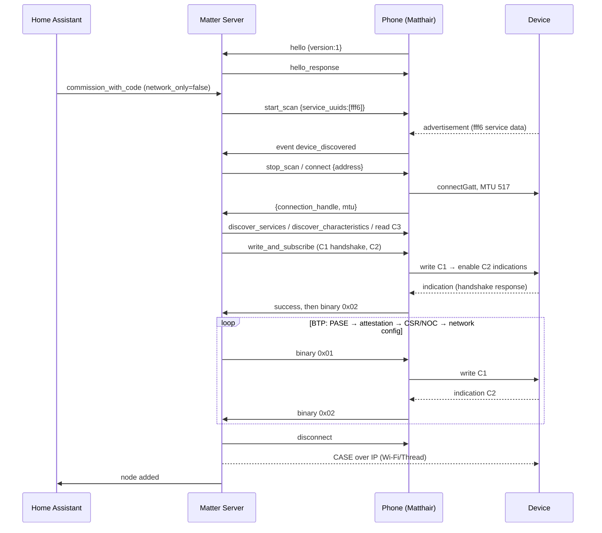

# BLE Proxy Protocol (matterjs-server `/ble`, v1)

This document describes the WebSocket protocol through which the Matter Server uses a remote
Bluetooth radio, and how Matthair implements the client side. It is written from the
upstream specification
([`docs/ble-proxy-protocol.md` in matter-js/matterjs-server](https://github.com/matter-js/matterjs-server/blob/main/docs/ble-proxy-protocol.md),
protocol version 1.0). If anything here contradicts upstream, **upstream wins**. Please open an
issue in that case.

Implementation: [`BleProxyClient.kt`](../app/src/main/java/io/github/dwicki/hamatterpair/ble/BleProxyClient.kt),
[`GattConnection.kt`](../app/src/main/java/io/github/dwicki/hamatterpair/ble/GattConnection.kt),
[`BleScanner.kt`](../app/src/main/java/io/github/dwicki/hamatterpair/ble/BleScanner.kt).

---

## 1. Roles

| Role | Who | Responsibility |
|------|-----|----------------|
| **Server** | Matter Server (matter.js), started with `ble_proxy` | The Matter **commissioner**. It decides what to scan, connect, read and write, and runs BTP, PASE, attestation, network setup and CASE. |
| **Client** | Matthair on the phone (also HA's own Bluetooth stack, ESPHome proxies via HA) | A "dumb" radio. It executes BLE operations and relays data. It holds no Matter state, fabric or keys. |
| **Peripheral** | The Matter device in commissioning mode | Advertises service `0xFFF6`, exposes characteristics C1/C2/C3. |

```
 Matter device  ──BLE──►  Phone (Matthair)  ──WSS /ble via HA ingress──►  Matter Server  ◄──HA WS── Home Assistant
   (peripheral)              (proxy client)                                  (commissioner)
```

## 2. Transport

* WebSocket on the server's port at path `/ble` (e.g. `ws://host:5580/ble`).
* **Text frames** carry JSON (commands, responses, events). **Binary frames** carry BTP data.
* The endpoint has **no authentication**. Matthair therefore never connects to port 5580
  directly. It uses Home Assistant ingress:
  `wss://<ha>/api/hassio_ingress/<token>/ble` with cookie `ingress_session=<session>`.
  The session comes from the Supervisor (`supervisor/api` → `POST /ingress/session`) and is only
  issued to an authenticated admin. See [arc42 §8.2](architecture/arc42.md#82-security-concept).

## 3. Lifecycle

1. Client opens the WebSocket.
2. Client sends `{"type":"hello","version":1}` **before anything else**.
3. Server answers `{"type":"hello_response","version":1}`, or with `error: "unsupported_version"`
   and then closes. Without a hello within 10 s the server closes.
4. Server sends commands, and the client answers each one exactly once.
5. Client sends unsolicited events (discoveries, notifications, disconnects).
6. Either side closes. The client must then release **all** BLE connections.

**Liveness:** after the handshake the server pings every 15 s and drops a client that has been
silent for more than 45 s. OkHttp answers pings automatically. Matthair additionally keeps the
process alive with a `connectedDevice` foreground service, so a screen-off kill does not leave
a dead client behind.

## 4. JSON envelopes

| Kind | Direction | Shape |
|------|-----------|-------|
| Command | server → client | `{"id": <int, increasing>, "command": "<name>", "args": {…}}` (`args` optional) |
| Success | client → server | `{"id": <same>, "success": true, "result": {…}}` |
| Error | client → server | `{"id": <same>, "success": false, "error": "<code>", "message": "<text>"}` |
| Event | client → server | `{"event": "<name>", "data": {…}}` |

## 5. Commands

| Command | Args | Result | Matthair implementation |
|---------|------|--------|---------------------------|
| `start_scan` | `service_uuids?` (default all), `allow_duplicates?` (default true) | `{}` | Acquires the shared `BleScanner` (filter: service data `0xFFF6`). Re-arming while scanning is a no-op success. |
| `stop_scan` | – | `{}` | Releases the scanner. The radio keeps running for 8 s of grace to dodge Android's scan throttling. |
| `connect` | `address`, `timeout?` (ms, default 30000) | `connection_handle`, `mtu` | Only for addresses this client reported. Stops scanning, `connectGatt(TRANSPORT_LE)`, up to 3 tries on GATT 133, then `requestMtu(517)` and `CONNECTION_PRIORITY_HIGH`. Handles are client-assigned 16-bit values. |
| `disconnect` | `connection_handle` | `{}` | `disconnect()`, 150 ms delay, `close()`. |
| `discover_services` | `connection_handle` | `services: [{uuid}]` | `discoverServices()`. UUIDs in short form for base UUIDs (`"fff6"`). |
| `discover_characteristics` | `connection_handle`, `service_uuid` | `characteristics: [{uuid, properties[]}]` | Properties: `read`, `write`, `write-without-response`, `notify`, `indicate`. |
| `read_characteristic` | `connection_handle`, `characteristic_uuid` | `value` (base64) | Used for C3. JSON result (no `0x03` frame). |
| `write_characteristic` | `connection_handle`, `characteristic_uuid`, `value` (b64), `response?` (default false) | `{}` | Sets the binary write context to this characteristic. |
| `subscribe_characteristic` | `connection_handle`, `characteristic_uuid` | `{}` | CCCD write: **indication** if supported (C2 uses indications), else notification. Sets the binary notify context. |
| `write_and_subscribe` | `connection_handle`, `write_uuid`, `write_value`, `write_response?`, `subscribe_uuid` | `{}` | See §5.1. |
| `unsubscribe_characteristic` | `connection_handle`, `characteristic_uuid` | `{}` | CCCD disable. `not_subscribed` if not active. |
| `request_mtu` | `connection_handle`, `mtu` | `mtu` | `requestMtu()`. |

### 5.1 `write_and_subscribe`, the step that breaks naive clients

The BTP handshake works like this: the server writes the handshake request to **C1**, and the
device answers with an **indication on C2** almost immediately. If the client answered the write
first and only then received a separate `subscribe` command, the indication could arrive
before the CCCD is enabled and be lost. The handshake then times out, which is what happened
with the original Noble reference client
([matterjs-server#1000](https://github.com/matter-js/matterjs-server/issues/1000)).

The client must therefore, **in one task**:

1. write `write_value` to `write_uuid` (as an ATT Write *Request* for C1),
2. wait for the GATT write response,
3. enable indications on `subscribe_uuid`,
4. answer success.

Matthair runs both GATT operations under one connection lock. Indications that arrive
between step 3 and the response are **buffered** and sent as `0x02` frames right after the
response. This keeps the order the server expects (response first, then data) without losing
the early handshake response.

### 5.2 GATT sequencing on Android

Android allows only one outstanding GATT operation per connection. Matthair queues every
command and every binary write of a connection in one FIFO channel that a single worker
coroutine drains. Each operation waits for its callback (10 s timeout) before the next starts.
Out-of-order or dropped writes are therefore impossible.

## 6. Events (client → server)

| Event | Data | When |
|-------|------|------|
| `device_discovered` | `address`, `connectable`, `name?`, `rssi?`, `service_data?` (`{"fff6": b64}`), `manufacturer_data?`, `service_uuids?` | Each advertisement while the server is scanning. Matthair only reports connectable Matter devices whose discriminator (and VID, if known) matches the code being commissioned. |
| `disconnected` | `connection_handle`, `reason?` | Unexpected link loss (not after `disconnect`). |
| `scan_stopped` | `reason` | Scan died on its own (e.g. adapter off). |
| `characteristic_notification` | `connection_handle`, `characteristic_uuid`, `value` (b64) | Notification on a characteristic other than the active notify context. |

## 7. Binary frames

```
 byte 0      bytes 1-2 (big endian)    bytes 3..N
 ┌────────┬──────────────────────────┬──────────────┐
 │ opcode │     connection_handle    │   payload    │
 └────────┴──────────────────────────┴──────────────┘
```

| Opcode | Name | Direction | Meaning |
|--------|------|-----------|---------|
| `0x01` | WRITE_DATA | server → client | Write payload to the characteristic of the last `write_characteristic`/`write_and_subscribe` on this handle (C1). **With response.** |
| `0x02` | NOTIFICATION | client → server | Data from the characteristic of the last `subscribe_characteristic`/`write_and_subscribe` (C2). |
| `0x03` | READ_RESPONSE | client → server | Optional binary result of `read_characteristic`. Not used by Matthair. |

Frames shorter than 3 bytes are invalid.

## 8. Multiple clients and ownership

Several clients may be connected: the phone, HA's own Bluetooth stack, and through HA any
ESPHome Bluetooth proxies.

* `start_scan`/`stop_scan` are **broadcast** to all clients.
* The **first client that reports a peripheral owns it**. All later commands for that address go
  only to the owner.
* If the owner disconnects, ownership moves to another client that also reported the device.
* Peripherals not reported for 15 min are forgotten at the next scan start.

**Consequence for the app:** if an ESPHome proxy near the device reports it before the phone
does, the server connects through that proxy. Matthair detects this ("device reported, but
no `connect` within 15 s") and tells the user instead of waiting silently. A per-attempt
`ble_proxy_id` option that pins the server to one proxy has been proposed upstream. Matthair
will use it once the server supports it ([arc42 §11](architecture/arc42.md#11-risks-and-technical-debt)).

## 9. Error codes

`bluetooth_unavailable`, `already_scanning`, `not_scanning`, `device_not_found`,
`connection_failed`, `already_connected`, `not_connected`, `timeout`, `service_not_found`,
`characteristic_not_found`, `read_failed`, `write_failed`, `subscribe_failed`, `not_subscribed`,
`notify_not_supported`, `mtu_request_failed`, `discovery_failed`, `internal_error`.

Matthair maps Android failures as follows: GATT status ≠ 0 becomes the operation-specific
`*_failed` code, a missing callback becomes `timeout`, a refused operation start becomes
`internal_error`, and an address the client never reported becomes `device_not_found`.

## 10. Matter GATT constants

| Name | UUID | Use |
|------|------|-----|
| Matter service | `0000FFF6-0000-1000-8000-00805F9B34FB` (`fff6`) | Advertised as **service data** with the 8-byte commissionable payload ([matter-protocol.md §2](matter-protocol.md#2-ble-advertisement)) |
| C1 | `18EE2EF5-263D-4559-959F-4F9C429F9D11` | BTP client → device, write with response |
| C2 | `18EE2EF5-263D-4559-959F-4F9C429F9D12` | BTP device → client, indications |
| C3 | `18EE2EF5-263D-4559-959F-4F9C429F9D13` | Additional commissioning data, read only |

Never read C2 while subscribed to it: on many stacks the read value comes back through the
notification path and would corrupt the BTP stream.

## 11. Typical sequence


